# keycloak-magic-link

<!-- phasetwo:banner:start - managed by p2-inc/shared-github-actions, edit there -->
[](https://github.com/p2-inc/keycloak-magic-link/actions/workflows/ci.yml) [](https://central.sonatype.com/artifact/io.phasetwo.keycloak/keycloak-magic-link) [](COPYING) [](https://phasetwo.io/docs/authentication/magic-links/)

📚 [Documentation](https://phasetwo.io/docs/authentication/magic-links/) • 🚀 [Hosted Keycloak](https://dash.phasetwo.io/?utm_source=github&utm_medium=readme&utm_campaign=keycloak-magic-link) • 🤖 [Keycloak Skills](https://github.com/p2-inc/keycloak-skills) • 💬 [Support](mailto:support@phasetwo.io)

> [!TIP]
> **Run this in our cloud, no setup needed.** Phase Two hosts Keycloak with this extension and the rest of ours built in. [Try it free with your own cluster →](https://dash.phasetwo.io/?utm_source=github&utm_medium=readme&utm_campaign=keycloak-magic-link)
>
> **Using a coding agent?** Add the Phase Two Keycloak skills ([launch post](https://phasetwo.io/blog/keycloak-skills-mcp-launch)) to Claude Code, Cursor or Codex so your agent can set up passwordless login, SSO, organizations and clusters for you:
>
> ```sh
> # Install the skills (connects to our hosted MCP server)
> claude plugin marketplace add p2-inc/keycloak-skills
> claude plugin install phasetwo@keycloak-skills
> # Or connect to the MCP server directly
> claude mcp add --transport http keycloak https://mcp.phasetwo.io/mcp
> ```
<!-- phasetwo:banner:end -->

Magic link implementation. Inspired by the [experiment](https://github.com/stianst/keycloak-experimental/tree/main/magic-link) by [@stianst](https://github.com/stianst).
It comes in two types: magic link and magic link continuation;

There is also a simple Email OTP authenticator implementation here.
This extension is used in the [Phase Two](https://phasetwo.io) cloud offering, and is released here as part of its commitment to making its [core extensions](https://phasetwo.io/docs/introduction/open-source) open source. Please consult the [license](COPYING) for information regarding use.

## Quick start

The easiest way to get started is our [Docker image](https://quay.io/repository/phasetwo/phasetwo-keycloak?tab=tags). Documentation and examples for using it are in the [phasetwo-containers](https://github.com/p2-inc/phasetwo-containers) repo. The most recent version of this extension is included.

## Magic link

This implementation differs from the original in that it creates an ActionToken that is sent as the link. This is convenient, as it does not require the user to click on the link from the same device. A common use case we heard was users entering their email address on the desktop, but then clicking on the link on their mobile, so we wanted to solve for that case.

This contains two pathways to get a Magic Link:

### Authenticator

An Authenticator that can run as a form in your login flow. This takes an email, and can optionally create a user if none exists. This implementation sends the email using a theme-resources template, which you can override. Installation can be achieved by duplicating the Browser flow, and replacing the normal Username/Password/OTP forms with the Magic Link execution type ([@tstec-polypoly](https://github.com/tstec-polypoly) provides a great step-by-step guide for setting it up https://github.com/p2-inc/keycloak-magic-link/issues/6#issuecomment-1230675741). Note that you aren't required to use a _Username form_ with this, as it extends `UsernamePasswordForm` and renders the username form page for you:

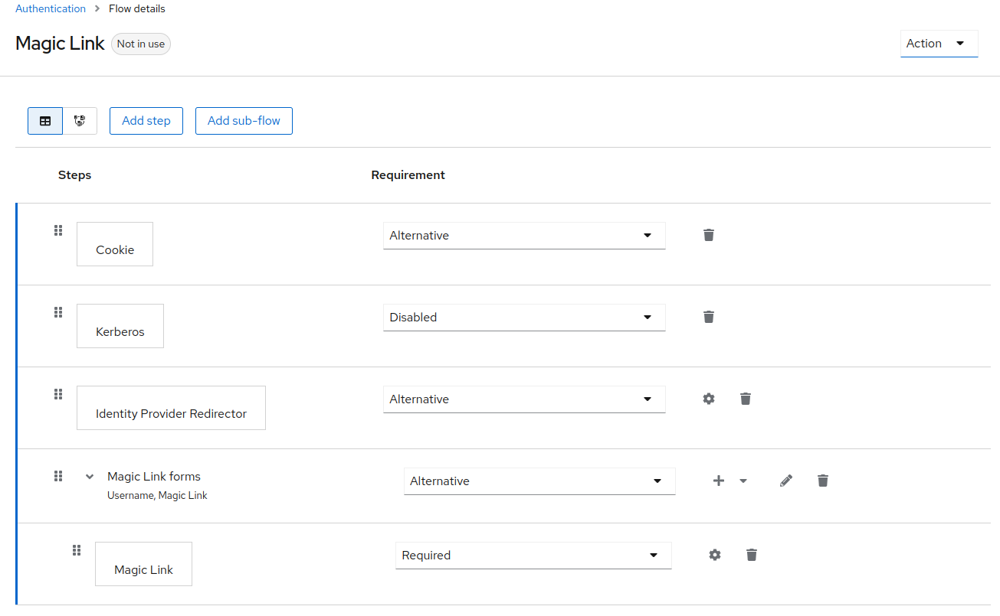

The authenticator can be configured to create a user with the given email address as username/email if none exists. It is also possible to force `UPDATE_PROFILE` and `UPDATE_PASSWORD` required actions when the user is created by this Authenticator:

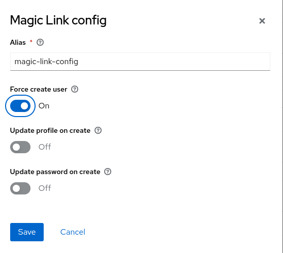

### Customization (SPI)

The core implementation is **closed for modification and open for extension**. All implementation classes (`MagicLinkAuthenticator`, `MagicLinkActionTokenHandler`) are `final` — do not fork this repository to patch them. Instead, **import this artifact as a Java library** in your own Keycloak extension project and extend it through the SPI:

```xml
<dependency>
  <groupId>io.phasetwo.keycloak</groupId>
  <artifactId>keycloak-magic-link</artifactId>
  <version>VERSION</version>
</dependency>
```

Custom behaviour is added by implementing two SPI interfaces and wiring them into a new authenticator factory subclass. The built-in defaults handle the common case — replace only what your use case requires.

#### How it fits together

```
AbstractMagicLinkAuthenticatorFactory  (subclass this)
  └── MagicLinkAuthenticator           (final — do not subclass)
        └── MagicLinkCustomizationProvider  (implement this interface)
              ├── canAuthenticate()    ← gate the flow (org check, role check, …)
              └── sendMagicLinkEmail() ← use built-in template or your own
```

#### Step 1 — Implement `MagicLinkCustomizationProvider`

```java
public final class AcmeMagicLinkCustomizationProvider implements MagicLinkCustomizationProvider {

    private final KeycloakSession session;

    AcmeMagicLinkCustomizationProvider(KeycloakSession session) {
        this.session = session;
    }

    @Override
    public boolean canAuthenticate(AuthenticationFlowContext context, UserModel user, MagicLinkConfig config) {
        // Return false (and set a challenge) to abort — e.g. role check, org membership
        if (user.getRoleMappingsStream().noneMatch(r -> "acme-user".equals(r.getName()))) {
            Response deny = context.form()
                .setError("notAllowed")
                .createErrorPage(Response.Status.FORBIDDEN);
            context.failure(AuthenticationFlowError.ACCESS_DENIED, deny);
            return false;
        }
        return true;
    }

    @Override
    public boolean sendMagicLinkEmail(KeycloakSession session, UserModel user, String link, MagicLinkConfig config) {
        return MagicLink.sendMagicLinkEmail(session, user, link); // built-in template; swap for your own
    }

    @Override
    public void close() {}
}
```

#### Step 2 — Implement `MagicLinkCustomizationProviderFactory`

```java
public final class AcmeMagicLinkCustomizationProviderFactory implements MagicLinkCustomizationProviderFactory {

    @Override
    public MagicLinkCustomizationProvider create(KeycloakSession session, Map<String, String> authenticatorConfig) {
        return new AcmeMagicLinkCustomizationProvider(session);
    }

    @Override
    public List<ProviderConfigProperty> getConfigProperties() {
        return List.of(); // add ProviderConfigProperty entries to expose admin-UI config fields
    }
}
```

#### Step 3 — Wire into an authenticator factory

Subclass `AbstractMagicLinkAuthenticatorFactory` and annotate with `@AutoService`. The `PROVIDER_ID` must be unique across your Keycloak installation.

```java
@AutoService(AuthenticatorFactory.class)
public final class AcmeMagicLinkAuthenticatorFactory extends AbstractMagicLinkAuthenticatorFactory {

    public static final String PROVIDER_ID = "ext-magic-acme";

    public AcmeMagicLinkAuthenticatorFactory() {
        super(new AcmeMagicLinkCustomizationProviderFactory());
    }

    @Override public String getId()          { return PROVIDER_ID; }
    @Override public String getDisplayType() { return "Magic Link (Acme)"; }
    @Override public String getHelpText()    { return "Magic link restricted to Acme users."; }
}
```

After building and deploying the JAR, **"Magic Link (Acme)"** appears in the Keycloak admin console alongside the default **"Magic Link"** option. Each variant is configured independently and can be used in any browser flow.

#### Exposing admin-UI config fields

`getConfigProperties()` in your factory returns additional `ProviderConfigProperty` entries that are appended to the authenticator's configuration panel in the admin UI, after the built-in properties.

```java
@Override
public List<ProviderConfigProperty> getConfigProperties() {
    ProviderConfigProperty orgId = new ProviderConfigProperty();
    orgId.setType(ProviderConfigProperty.STRING_TYPE);
    orgId.setName("acme-org-id");
    orgId.setLabel("Organization ID");
    orgId.setHelpText("Only members of this organization may receive a magic link.");
    return List.of(orgId);
}
```

The same config map is passed to `create(session, authenticatorConfig)` at runtime:

```java
@Override
public MagicLinkCustomizationProvider create(KeycloakSession session, Map<String, String> authenticatorConfig) {
    String orgId = authenticatorConfig.get("acme-org-id");
    return new AcmeMagicLinkCustomizationProvider(session, orgId);
}
```

#### Built-in default

When no customization is needed the provided `DefaultMagicLinkCustomizationProviderFactory` is used automatically. It allows all users through `canAuthenticate` and delegates to the built-in `magic-link-email.ftl` template.

---

## Magic link continuation

This Magic link continuation authenticator is similar to the Magic Link authenticator in implementation, but has a different behavior. Instead of creating a session on the device where the link is clicked, the flow continues the login on the initial login page. The login page is polling the authentication page each 5 seconds until the session is confirmed or the authentication flow expires. The default expiration for the Magic link continuation flow is 10 minutes.

### Authenticator

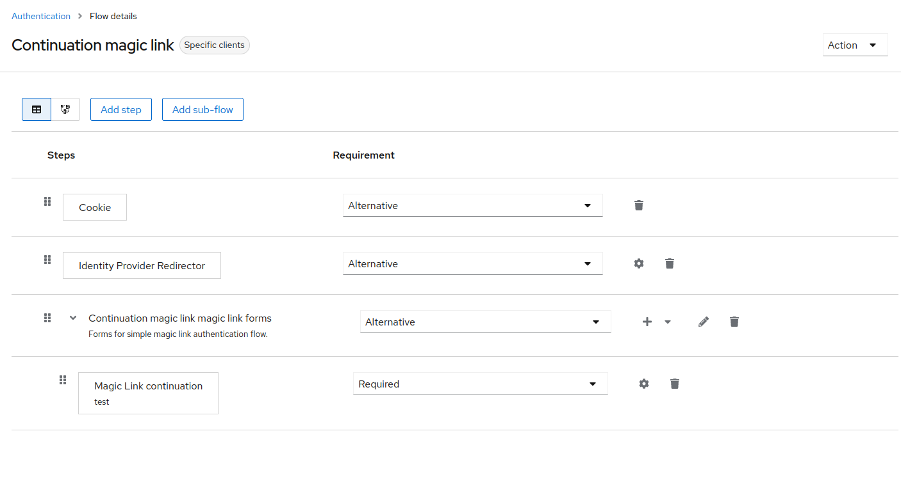

The authenticator can be configured to set the expiration of the authentication flow.

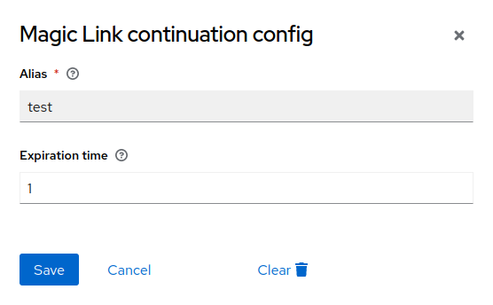

When the period is exceeded the authentication flow will reset.

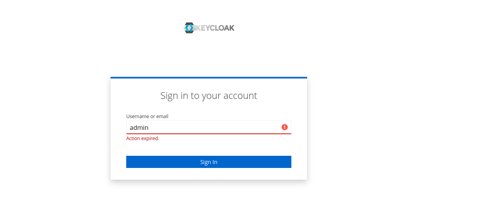

### Customization

`MagicLinkContinuationAuthenticator` is `final` and does **not** participate in the `MagicLinkCustomizationSpi`. Its cross-device polling flow is self-contained: email sending and user validation are fixed to the built-in behaviour. To change that behaviour, implement a new `Authenticator` (extending `UsernamePasswordForm`) and register it with its own `AuthenticatorFactory` — not by subclassing any continuation class.

### Keycloakify Theme Templates

If you are using Keycloakify and need the templates, you can find them in our Keycloakify Starter [fork](https://github.com/p2-inc/keycloakify-starter/tree/p2/magic-link-extension-templates) (go into the [pages](https://github.com/p2-inc/keycloakify-starter/tree/p2/magic-link-extension-templates/src/login/pages) folder).

### Resource

A Resource you can call with `manage-users` role, which allows you to specify the email, clientId, redirectUri, tokenExpiry and optionally if the email is sent, or the link is just returned to the caller.

Resources created with this API method return a URL that uses an Action Token. This will log a user in directly and skip any Authentication Flows defined.

Parameters:
| Name | Required | Default | Description |
| ----- | ----- | ----- | ----- |
| `email` | Y | | Email address associated with the User to create the magic link for. |
| `username` | N | | Username of the User to create the magic link for. Ignores email and forces `force_create`, `update_profile`, `update_password` and `send_email` to `false` if set. |
| `client_id` | Y | | Client ID the user will be logging in to. |
| `redirect_uri` | Y | | Redirect URI. Must be valid for the given client. |
| `expiration_seconds` | N | 86400 (1 day) | Amount of time the magic link is valid. |
| `force_create` | N | false | Create a user with this email address as username/email if none exists. |
| `update_profile` | N | false | Add an UPDATE_PROFILE required action if the user was created. |
| `update_password` | N | false | Add an UPDATE_PASSWORD required action if the user was created. |
| `send_email` | N | false | Send the magic link email using the built in template. |
| `scope` | N | | OIDC `scope` variable. |
| `nonce` | N | | OIDC `nonce` variable. |
| `state` | N | | OIDC `state` variable. |
| `code_challenge` | N | | OIDC `code_challenge` variable (for PKCE). |
| `remember_me` | N | false | If the user is treated as if they had checked "Remember Me" on login. Requires that it is enabled in the Realm. |
| `reusable` | N | true | If the token can be reused multiple times during its validity |
| `response_mode` | N | query | Determines how the authorization response is returned to the client: in the URL query string (query) or in the URL fragment (fragment). SPAs should usually pass `fragment` together with a `state`; see [Using magic links with a single-page app](#using-magic-links-with-a-single-page-app-keycloak-js-oidc-client-ts-). |

Sample request (replace your access token):

```
curl --request POST https://keycloak.host/auth/realms/test/magic-link \
 --header "Accept: application/json" \
 --header "Content-Type: application/json" \
 --header "Authorization: Bearer <access_token>" \
 --data '{"email":"foo@foo.com","client_id":"account-console","redirect_uri":"https://keycloak.host/auth/realms/test/account/","expiration_seconds":3600,"force_create":true,"update_profile":true,"update_password":true,"send_email":false}'
```

Sample response:

```
{
  "user_id": "386edecf-3e43-41fd-886c-c674eea41034",
  "link": "https://keycloak.host/auth/realms/test/login-actions/action-token?key=eyJhbG...KWuDyE&client_id=account-console",
  "sent": false
}
```

#### Using magic links with a single-page app (keycloak-js, oidc-client-ts, …)

A magic link is an *unsolicited* authorization response: the SPA never started this login, so it has
no matching `state`, `nonce` or PKCE verifier stored. By default the callback is sent in **query**
mode with **no `state`**:

```
https://app.example.com/?session_state=…&iss=…&code=…
```

keycloak-js defaults to `responseMode: 'fragment'` and only reads the fragment, so it ignores that
URL and starts a new login with the whole URL, `code` included, as `redirect_uri`. Since Keycloak
26.6.5 / 26.4.14 ([CVE-2026-9689](https://github.com/keycloak/keycloak/issues/49430)) a
`redirect_uri` containing `code`, `state`, `iss` or `session_state` is rejected with
`Invalid parameter: redirect_uri`.

To make the callback something the SPA recognises, pass the **same response mode your client uses**
(`fragment` for keycloak-js by default) **plus a `state`**. Both are needed: `state` alone still
lands in the query string, where a fragment-mode client never looks.

```json
{
  "email": "foo@foo.com",
  "client_id": "my-spa",
  "redirect_uri": "https://app.example.com/",
  "response_mode": "fragment",
  "state": "<random value>"
}
```

The callback then arrives as `https://app.example.com/#state=…&session_state=…&iss=…&code=…`.
keycloak-js strips those parameters from the URL. It rejects the callback because it didn't issue
that `state`, and starts a normal login from the clean URL. Opening the magic link already created
an SSO session, so Keycloak returns a new code at once and the user is signed in without a prompt.
keycloak-js only treats the URL as a callback when it carries both `code` and `state` in the part
it parses. Without `state` it leaves the parameters in place and reuses them in the next
`redirect_uri`. That happens to pass today in fragment mode, because the CVE-2026-9689 check only
inspects the query string, but don't rely on it.

| Magic-link request | SPA `responseMode` | Result on Keycloak ≥ 26.6.5 |
| --- | --- | --- |
| neither `state` nor `response_mode` | `fragment` (default) | `Invalid parameter: redirect_uri` |
| `state` (query mode) | `fragment` (default) | `Invalid parameter: redirect_uri` |
| `state` + `response_mode: "fragment"` | `fragment` (default) | signed in |
| `state` + `response_mode: "query"` | `query` | signed in |

If you can't change how links are created, strip the stale OIDC parameters (`code`, `state`,
`session_state`, `iss`, `error`, …) from the URL before initialising the OIDC client, as the
Keycloak consoles do ([keycloak#52462](https://github.com/keycloak/keycloak/pull/52462)).

---

## Login Token

Login Token is a drop-in parallel implementation that can be deployed alongside the existing Magic Link without any breaking changes or flow migration.

### Why Login Token?

The original Magic Link authenticates the user *directly* via the action-token handler, bypassing the standard Keycloak browser flow entirely. This means:

- `acr_values` / step-up authentication cannot be evaluated natively.
- Subsequent authenticators (e.g. TOTP for LOA=2) cannot run in the same browser session.

Login Token solves this by returning a **login token** instead of an action-token URL. The token is passed to Keycloak in `login_hint`, either as a short reference to a credential stored server-side (`lt:{uuid}`, the [legacy token format](#token-formats-stateless-and-legacy)) or as a self-contained encrypted credential (`lt:v2.…`, the stateless format). The standard browser flow runs in full — `acr_values`, `Condition – Level of Authentication`, and all step-up logic work natively.

### How it works

The walkthrough below shows the legacy token format. A stateless token takes the same path through the flow; only steps 2 and 3 differ — see [Token formats](#token-formats-stateless-and-legacy).

```
POST /realms/{realm}/login-token
  → credential data (userId, clientId, expiry, optional LOA/rememberMe)
    stored in Infinispan under key "lt:data:{uuid}" with the requested TTL
  → returns: { "login_hint": "lt:{uuid}" }

Caller constructs the OIDC authorization URL and opens it in the browser:
  https://keycloak.host/realms/{realm}/protocol/openid-connect/auth
    ?client_id=myapp
    &response_type=code
    &login_hint=lt:{uuid}       ← returned login_hint passed verbatim
    &prompt=login               ← required (see note below)
    &redirect_uri=...           ← caller's redirect URI
    &code_challenge=...         ← caller's PKCE challenge
    &state=...                  ← caller's state
    [+ any other OIDC params]

  → standard OIDC browser flow starts
  → Login Token Verifier (login-token-verifier) resolves the credential:
      1. Strips "lt:" prefix from login_hint to get the UUID
      2. Looks up credential data in Infinispan by "lt:data:{uuid}"
      3. Checks expiry (TTL-enforced by Infinispan + explicit timestamp check)
      4. Verifies stored clientId matches the current OIDC client
      5. Enforces the use limit via putIfAbsent("lt:used:{uuid}", ttl)
         (skipped for tokens without a limit)
      6. Sets user, optional LOA, optional remember-me
      7. context.success() → flow continues normally
  → Any subsequent step-up authenticators run in the same browser session
```

> **`prompt=login` is required.** Without it, Keycloak may find an existing session cookie before
> the Login Token Verifier runs and pre-populate the auth session with the cookie user.
> This causes an `already authenticated as different user` error when the Verifier later tries
> to authenticate the login token target user.

> **Why not a signed JWT?**  Keycloak silently ignores a `login_hint` longer than 255
> characters. A typical HS512/RS256 JWT is 500–700 characters and would be dropped, causing
> authentication to fail silently. Both token formats stay well below the limit: the legacy
> reference (`lt:{uuid}`) is 39 characters, a stateless token is typically 75–105.

### Token formats: stateless and legacy

A Login Token exists in two formats. Both are redeemed by the same authenticators and can be in circulation at the same time; the format is recognised from the `login_hint` itself.

| | Legacy token format | Stateless token format |
| --- | --- | --- |
| `login_hint` | `lt:{uuid}` | `lt:v2.{base64url}` |
| Where the credential lives | In Keycloak's single-use object store (Infinispan), for the whole lifetime of the token | Inside the token, encrypted |
| Stored when the token is created | One entry per token | Nothing |
| Stored when the token is redeemed | One marker per use, only for use-limited tokens | One marker per use, only for use-limited tokens |
| Survives a full cluster restart | No | Yes |
| What the holder of the link can read | Nothing (opaque reference) | Nothing (encrypted) |
| Requires | Nothing | An AES key provider named `login-token` in the realm |

#### Why the stateless format exists

The legacy format keeps every issued token in Infinispan until it expires. That store is in-memory, replicated across the Keycloak nodes and has no size limit, so the memory it needs grows with *tokens issued per day × lifetime*. For interactive use — a handful of short-lived tokens — this is irrelevant. For campaigns it is not: 3.4 million tokens a day with a 7-day lifetime means about 24 million live entries, each held twice in the cluster. That is tens of gigabytes of heap for tokens most recipients never use, it has to be moved between nodes on every deployment or scaling step, and all of it is lost if the cluster restarts.

A stateless token carries its own content, so issuing one stores nothing. Keycloak only writes when a *use-limited* token is actually redeemed, and then just a small marker. Memory use follows the number of redemptions rather than the number of tokens sent.

#### How a stateless token is built

```
lt:v2.<base64url( nonce[12] ‖ ciphertext ‖ tag[16] )>
```

- The payload — user id, optional client id, expiry, optional LOA, use limit and the `remember_me` / `set_email_verified` / `confirm_user_switch` flags — is packed into a compact binary form and encrypted with **AES-GCM**. GCM is authenticated encryption: the token cannot be read *and* cannot be modified without the key. Changing a single bit makes it invalid.
- The realm id is bound to the token as additional authenticated data. A token is only accepted by the realm that issued it.
- The random nonce doubles as the token's identity for use counting (`lt:used:{nonce}`), so no separate id is needed.

Verification replaces the Infinispan lookup of the legacy format (steps 2 and 3 above) with *decrypt and check the expiry inside the token*. Everything after that — client binding, user lookup, user-switch handling, use limit, LOA — is shared.

#### Setting up the key

Stateless tokens are encrypted with a dedicated key provider of the realm, so the key is stored in the database, identical on every node, and can be rotated without touching anything else Keycloak encrypts.

1. In the admin console open **Realm settings → Keys → Add providers** and choose **aes-generated**.
2. Set **Name** to `login-token` (the plugin finds the key by this name), **AES key size** to `32`, and **Priority** to a value **below 100**, e.g. `10`. Keycloak's own key providers use priority 100; staying below it guarantees Keycloak never picks this key for its own purposes.

Then choose who issues stateless tokens:

- **Per request:** send `"stateless": true` in the `POST /login-token` body.
- **Server-wide default:** start Keycloak with `--spi-realm-restapi-extension--login-token--stateless=true`. A request can still opt out with `"stateless": false`.

If a stateless token is requested but cannot be issued — the realm has no active `login-token` key, or the payload does not fit into 255 characters (for example a very long federated user id) — the endpoint logs a warning and returns a **legacy token** instead. Issuing never fails because of the format.

> **Rolling out to an existing cluster.** A node running an older version of this plugin cannot
> verify stateless tokens. First deploy the new version to every node, *then* start issuing
> stateless tokens (per request or via the server default). Turning the option off again is the
> way back: tokens already issued in either format keep working.

**Key rotation.** Add a second `aes-generated` provider with the same name `login-token` and a higher priority (still below 100). New tokens are encrypted with it. Leave the old provider enabled for as long as tokens issued under it may still be valid, then delete it. AES-GCM with random nonces should not encrypt more than about 4 billion tokens under one key, so rotate at least once a year at campaign volumes.

**Kill switch.** Deleting or disabling the key provider invalidates every stateless token issued under it at once. An individual stateless token cannot be revoked before it expires; choose `expiration_seconds` accordingly.

#### The legacy token format

Tokens in the legacy format are fully supported and remain the default:

- A `login_hint` of the form `lt:{uuid}` is always resolved through the single-use object store, exactly as before. Tokens issued before an upgrade stay valid until they expire.
- Legacy tokens stored by a version that predates `max_uses` only carry the `reusable` flag. They keep their meaning: `reusable: true` is unlimited, anything else is single use.
- A single-use legacy token redeemed on an old node during a rolling upgrade is also seen as redeemed by the new nodes, and vice versa.

Use the legacy format when you want nothing but the default Keycloak setup, or when you need tokens to disappear on their own if the cluster state is wiped. Use the stateless format whenever tokens are issued in bulk or live longer than a few minutes.

### REST API — `/login-token`

Requires `manage-users` role (same as `/magic-link`).

**Parameters:**

| Name | Required | Default | Description |
| ----- | ----- | ----- | ----- |
| `user_id` | Y* | | Keycloak user ID. Takes precedence over `email` and `username` when provided. `force_create` is ignored. |
| `email` | Y* | | Email address of the user. Mutually exclusive with `username`. |
| `username` | Y* | | Username of the user. When provided, `force_create` is ignored. |
| `client_id` | N | | Client ID the token is bound to. When set, redemption from any other client is rejected — this is always enforced. When omitted, an unbound ("universal") token is created that is only accepted by authenticator executions configured with **Client ID must match** = OFF (see [Client binding](#client-binding--universal-tokens)). |
| `expiration_seconds` | N | 300 (5 min) | Token validity in seconds. |
| `loa` | N | | Force the session to this LOA level, overriding the flow's Condition configuration. |
| `remember_me` | N | false | Set the remember-me flag on the session. |
| `force_create` | N | false | Create the user if they do not exist (email only). |
| `max_uses` | N | 0 | How often the token may be redeemed within its validity window: `0` = unlimited, `1` = single use, up to `10`. Values outside `0`–`10` are rejected with `400`. |
| `reusable` | N | | Legacy form of `max_uses`, still accepted: `true` = unlimited, `false` = single use. Ignored when `max_uses` is set. |
| `stateless` | N | server default (`false`) | `true` issues a token in the [stateless format](#token-formats-stateless-and-legacy), `false` one in the legacy format. When omitted, the server default applies. |
| `set_email_verified` | N | false | When `true`, marks the user's email as verified after the token is successfully validated. |
| `confirm_user_switch` | N | false | Controls behaviour when a different user is already logged in on the device. When `false` (default), the existing session is silently logged out and the login token is processed automatically. When `true`, a confirmation screen is shown asking the user to approve the logout before continuing. |

*One of `user_id`, `email`, or `username` is required. `user_id` takes precedence if multiple are provided.

### Client binding / universal tokens

By default, every Login Token is **bound to one client**: the `client_id` stored at generation time must match the client of the session in which the token is redeemed. This limits the blast radius of a leaked token — it can only be redeemed through the bound client, whose redirect-URI allowlist and PKCE configuration control where the authorization code can flow.

For use cases where the target client is not known at generation time — e.g. **QR-code login**, where a user generates a token in account management and any of several apps may scan it — the binding can be relaxed:

1. Omit `client_id` in the `POST /login-token` request. This creates an **unbound ("universal") token**.
2. Set the **Client ID must match** option to `OFF` on the authenticator execution(s) that should accept unbound tokens (available on `Login Token (with login_hint)`, `Login Token`, and `Login Token Direct Grant`).

The option semantics are:

| Token has `client_id` | **Client ID must match** = ON (default) | **Client ID must match** = OFF |
| --- | --- | --- |
| Yes, matches session client | ✅ accepted | ✅ accepted |
| Yes, different client | ❌ rejected | ❌ **still rejected** |
| No (universal token) | ❌ rejected | ✅ accepted |

A `client_id` that **is** present on a token is always enforced — the toggle only controls whether tokens *without* a binding are accepted. This means bound and unbound tokens can safely coexist in the same realm: creating a bound token is a guarantee that it cannot be redeemed elsewhere, regardless of how the flows are configured.

**Security recommendations for unbound tokens:**

- Use a **short `expiration_seconds`** (30–120 s). Unbound tokens are meant to be displayed live (e.g. as a QR code), not sent over long-lived channels like email.
- Set **`max_uses: 1`**. A universal token is password-equivalent for *every* client in the realm during its lifetime; single-use minimizes the window.
- Be aware that with **Client ID must match** = OFF, the *least strictly configured* client in the realm defines the security level for a stolen token — review clients with permissive redirect URIs (wildcards, `localhost`) and clients with Direct Access Grants enabled.
- Do not enable unbound tokens in realms that allow **anonymous dynamic client registration** — an attacker could register a client with an arbitrary redirect URI and redeem stolen tokens there.
- Keep the default (ON) on executions that do not need universal tokens; enable OFF only on the specific flow that serves the QR-login use case.

When the token is transported over email or other uncontrolled channels, or when the target app is known in advance, keep using bound tokens — the binding prevents cross-app replay (e.g. a token issued for a customer app being redeemed against an internal admin portal in the same realm) and gives audit logs a verifiable issued-for/redeemed-at client pair.

> **Important: place the Login Token Verifier before the Cookie authenticator in your flow.**
> Keycloak evaluates ALTERNATIVE executions in order and stops at the first success. If Cookie
> runs before the Verifier and an active session exists, Keycloak silently returns that session's
> token — even if it belongs to a different user than the one in the login token. Placing the
> Verifier first ensures it always gets to evaluate `login_hint` before Cookie can short-circuit
> the flow:
>
> ```
> Browser Flow
> ├── Login Token Verifier  [ALTERNATIVE]  ← must be first
> ├── Cookie                [ALTERNATIVE]
> ├── Kerberos              [ALTERNATIVE]
> └── Username/Password     [ALTERNATIVE]
> ```

**Sample request:**

```
curl --request POST https://keycloak.host/realms/test/login-token \
 --header "Accept: application/json" \
 --header "Content-Type: application/json" \
 --header "Authorization: Bearer <access_token>" \
 --data '{
   "email": "foo@example.com",
   "client_id": "myapp",
   "expiration_seconds": 300
 }'
```

**Sample response:**

```json
{
  "login_hint": "lt:5713e2a7-53a6-4fbc-8ff5-53d5d8862418"
}
```

With `"stateless": true` the response has the same shape and the `login_hint` starts with `lt:v2.`. Pass it on verbatim in both cases; callers do not need to tell the formats apart.

The caller then constructs the OIDC authorization URL using the returned `login_hint` and opens it in the browser (or sends it to the user by email/SMS):

```
https://keycloak.host/realms/test/protocol/openid-connect/auth
  ?client_id=myapp
  &response_type=code
  &login_hint=lt:5713e2a7-53a6-4fbc-8ff5-53d5d8862418
  &prompt=login
  &redirect_uri=https://myapp.example.com/callback
  &scope=openid profile
  &state=abc123
  &nonce=xyz789
  &code_challenge=<S256-challenge>
  &code_challenge_method=S256
```

The caller is fully responsible for PKCE (`code_challenge`, `code_challenge_method`, `code_verifier`), `state`, `nonce`, `redirect_uri`, and `scope`. This design ensures that the entity generating the PKCE `code_verifier` is always the same entity that handles the authorization code callback — regardless of whether the link is opened on the same device or clicked on a different device (e.g. from an email).

### User-switch behaviour

When a login token is opened for User B while User A is already logged in on the same device, the verifier detects the session conflict and handles it based on the `confirm_user_switch` parameter:

**Default (`confirm_user_switch: false`) — automatic logout:**
The existing session cookies are silently expired and the browser is redirected to a fresh OIDC authorization request. The login token is still valid (a use is not counted until authentication completes), so the fresh flow picks it up and logs User B in transparently — no screen is shown.

**`confirm_user_switch: true` — confirmation screen:**
A confirmation page is shown informing the user that they are currently signed in on this device and asking whether they want to continue. Two options are presented:
- **Sign out and continue** — performs the same automatic logout and redirect as the default behaviour.
- **Cancel** — aborts the flow and redirects back to the client with `error=access_denied`.

### Login Token (form-based)

In addition to the `login_hint`-based flow, there is a form-based authenticator that presents a UI input field so users can manually enter a login token.

**Provider ID:** `login-token-form` · **UI display name:** `Login Token`

The form accepts the token with or without the `lt:` prefix — the prefix is added automatically if absent. On an invalid or expired token the form is re-displayed with an error message; the flow never falls through silently to the next alternative.

**Placement:** Add as `ALTERNATIVE` or `REQUIRED` in the browser flow. Unlike `Login Token (with login_hint)`, this authenticator always shows a UI — do not place it before the Cookie authenticator unless you want every unauthenticated visit to show the token form.

**User-switch behaviour:** When a user-switch is needed (an active session exists for a different user), the confirmation dialog is always shown regardless of the token's `confirm_user_switch` flag. Auto-logout without confirmation is inappropriate in an interactive form context. After confirmation, session cookies are expired and the browser is redirected to a fresh OIDC authorization URL with `login_hint=lt:{tokenId}` so that `Login Token (with login_hint)` can complete the authentication automatically if it is present in the same flow.

**Example flow using both authenticators:**

```
Browser Flow
├── Login Token (with login_hint)  [ALTERNATIVE]  ← automated redemption via login_hint
├── Cookie                         [ALTERNATIVE]
└── Forms sub-flow                 [ALTERNATIVE]
    └── Login Token                [ALTERNATIVE]  ← manual entry form as fallback
```

---

## Email OTP

There is a simple authenticator to email a 6-digit OTP to the users email address. This implementation sends the email using a theme-resources template, which you can override. It is recommended to use this in an Authentication flow following the _Username form_. An example flow looks like this:
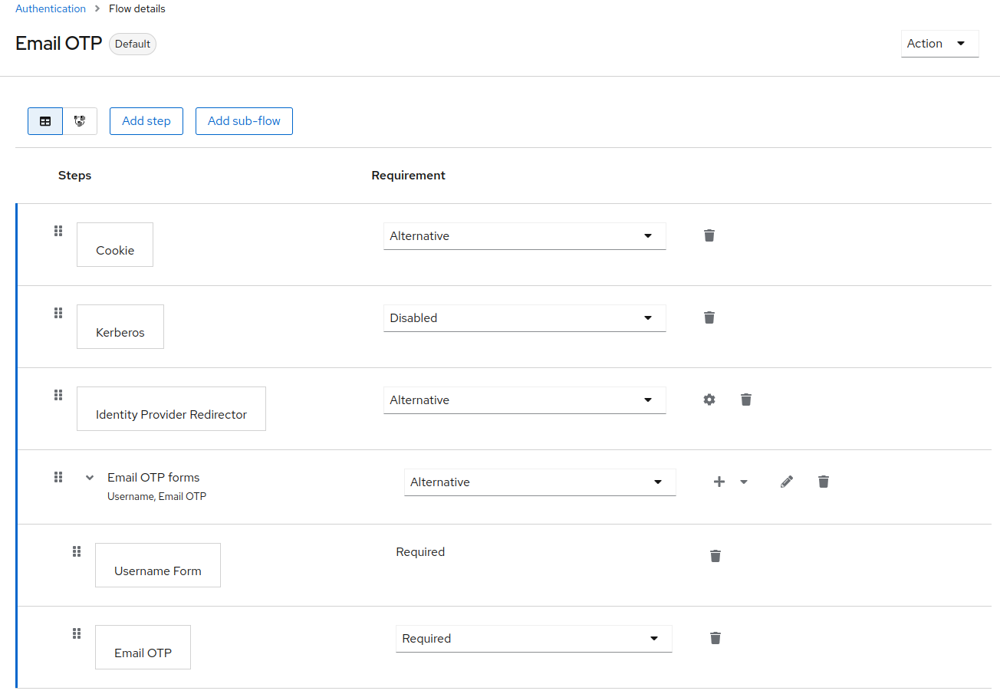

## Account Activation

Two authenticators route users by account status, for realms where some accounts still need activation before password login makes sense — typically self-registered users awaiting email verification, and migrated users created without a password who set their first password through an emailed link.

An account is treated as **pending activation** when any enabled criterion matches (all configurable per execution):

- the user's email address is not verified (`Pending when email unverified`, default on),
- the user has no password credential (`Pending when no password`, default on),
- the user has one of the configured required actions outstanding (`Pending required actions`, comma-separated aliases, default empty).

Both authenticators send the same activation email: a standard Keycloak execute-actions token link that opens the user's outstanding required actions directly in whatever browser it is clicked in, then returns the user to the application. By default (`Activation email actions` = `derive`) the link performs the user's own outstanding actions, plus `VERIFY_EMAIL` if their email is unverified and `UPDATE_PASSWORD` if they have no password — so one configuration covers both self-registered and migrated accounts without any custom status attribute. Set it to `explicit` to send a fixed list instead. The email subject and body use the `activationEmail*` message keys and the `activation-email.ftl` theme-resources template, all overridable from a login/email theme.

### Activation Gate (`ext-auth-activation-gate`)

Email-first browser-flow authenticator. Renders the email-only login form (or consumes an attempted username set by a previous authenticator), then branches:

- **Activated account** — sets the user on the flow and succeeds, so the next execution (typically _Password Form_) prompts for the credential. MFA executions later in the flow run as usual.
- **Pending account** — sends the activation email and shows a confirmation screen (`view-activation-sent.ftl`) with a Resend button. Resends are throttled by the `Resend cooldown` execution setting (default 30 s per authentication session).
- **Unknown, disabled, or email-less account** — shows the *same* confirmation screen without sending anything. There is deliberately no "email not registered" message and no option to enable one: the response must not disclose whether an account exists.

Example flow:

```
Browser Flow
├── Cookie                      [ALTERNATIVE]
└── Forms sub-flow              [ALTERNATIVE]
    ├── Activation Gate         [REQUIRED]
    ├── Password Form           [REQUIRED]
    └── Conditional OTP …       [CONDITIONAL]
```

### Send Activation or Reset Email (`ext-auth-activation-reset-email`)

Drop-in replacement for the built-in _Send Reset Email_ execution in the _Reset Credentials_ flow. Activated accounts get the stock behavior unchanged (a standard password-reset email — the built-in implementation is delegated to, including its `force-login` setting). Pending accounts get the activation email instead, so a not-yet-activated user who clicks "Forgot password?" is routed to activation rather than a reset that cannot help them. Every branch shows Keycloak's generic "you should receive an email shortly" message, and unknown users keep the stock (non-disclosing) behavior.

```
Reset Credentials Flow
├── Choose User                     [REQUIRED]
├── Send Activation or Reset Email  [REQUIRED]   ← replaces Send Reset Email
└── Reset Password                  [REQUIRED]
```

## Cloudflare Turnstile CAPTCHA

There are three [Cloudflare Turnstile](https://www.cloudflare.com/application-services/products/turnstile/) integrations available, each suited for a different flow type. All three share the same configuration — you will need a Cloudflare account with a Turnstile widget set up to obtain a **Site Key**, **Secret**, and **Action** value.

Before using any of them:

- Go to **Realm Settings → Security Defenses → Content-Security-Policy** and add `https://challenges.cloudflare.com` to the `frame-src` directive (space-separated list) so Keycloak can load the Turnstile widget.
- Set the login theme to `cloudflare-turnstile`. This can be applied to the entire realm under **Realm Settings → Themes → Login theme**, or to a specific client under the client's **Settings → Login settings → Login theme**.

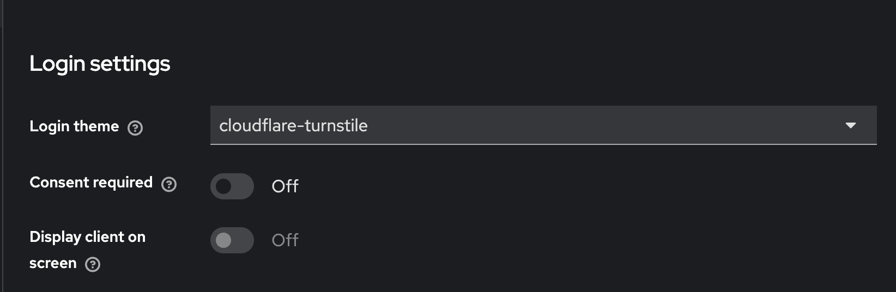

All three share the same configuration dialog — enter your **Turnstile Site Key**, **Turnstile Secret**, and **Action** from your Cloudflare dashboard:

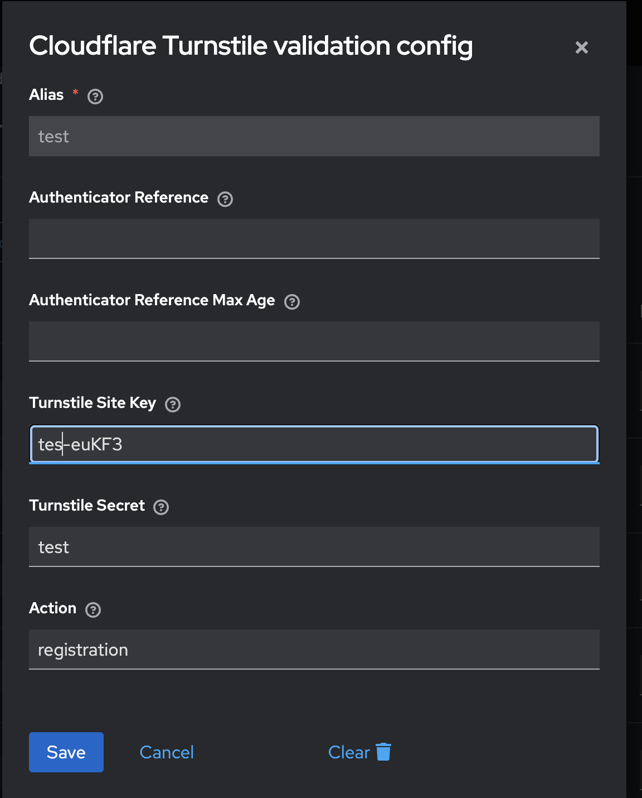

### Cloudflare Turnstile Validation (standalone)

**Display name:** `Cloudflare Turnstile validation`

A standalone authenticator step that presents a dedicated Turnstile challenge page to the user. This is the most flexible option — it can be placed before any step in a login flow that needs bot protection (e.g., before Magic Link or Email OTP). It does not require the user to be identified beforehand.

**When to use:** Add it as a step in your browser flow immediately before any authenticator you want to protect, such as the Magic Link authenticator.

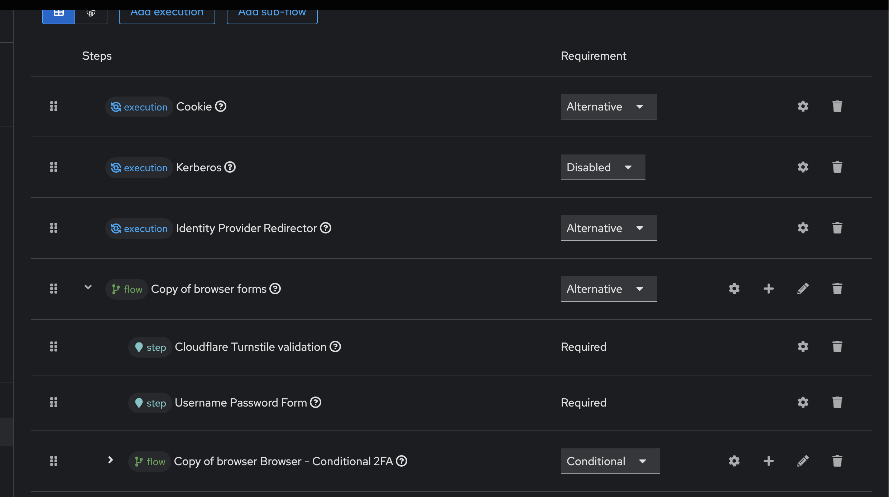

### Cloudflare Turnstile Username Password Form

**Display name:** `Cloudflare Turnstile Username Password Form`

A drop-in replacement for Keycloak's standard **Username Password Form** step. It embeds the Turnstile widget directly into the login page alongside the username and password fields, so users complete the CAPTCHA as part of signing in rather than on a separate page.

If the Turnstile check fails but the user provides valid credentials, the authenticator can optionally flag the account for email verification before the session is granted. This is controlled by the **Verify email on CAPTCHA failure** configuration option, which is **disabled by default**. When enabled, it acts as a rudimentary MFA fallback for environments that do not support full 2FA flows — legitimate users are not hard-blocked but must verify their email, raising friction for bots.

> **Note:** If the authenticator configuration is missing or incomplete (no Site Key, Secret, or Action set), it falls back to behaving exactly like the standard Keycloak Username Password Form — no CAPTCHA is shown and login proceeds normally.

**When to use:** Replace the standard `Username Password Form` execution in a browser flow when you want Turnstile protection on the login page itself without adding a separate step.

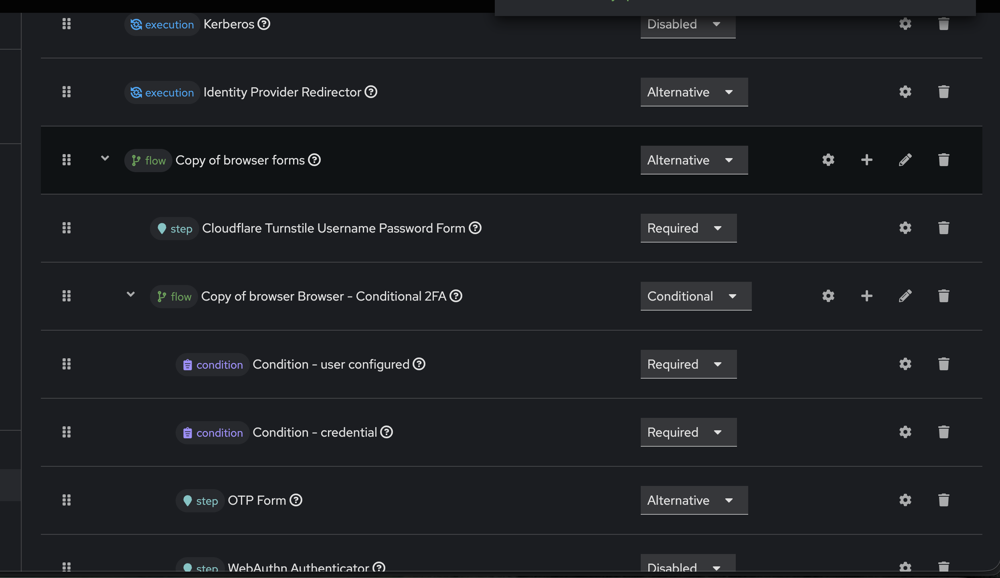

#### Use case: CAPTCHA-gated 2FA

A powerful pattern enabled by combining this authenticator with the **Condition - Turnstile Failed** conditional authenticator is CAPTCHA-controlled 2FA enforcement. The idea is to place a conditional subflow after the login step that contains your 2FA executions (OTP, WebAuthn, etc.) and use the two conditions below to decide when it runs.

**2FA triggered by Turnstile failure**

Add `Condition - Turnstile Failed` as **Required** inside the conditional subflow. The 2FA challenge is only presented to users for whom the CAPTCHA failed — suspected bots or automated submissions — while normal users who pass the widget proceed without any extra step.

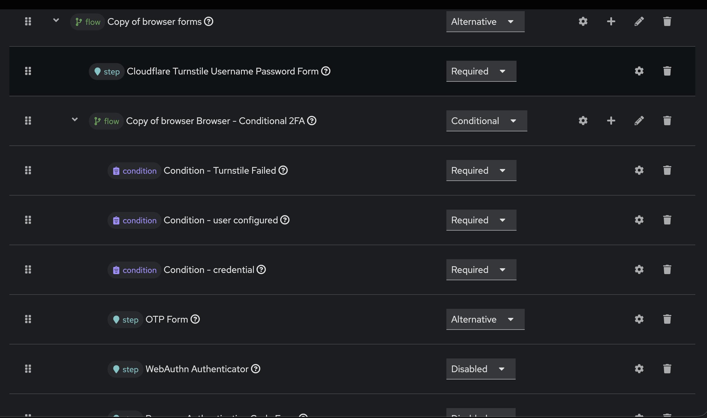

**2FA based on user settings**

Set `Condition - Turnstile Failed` to **Disabled** and rely solely on `Condition - user configured` and `Condition - credential`. The 2FA subflow now runs for any user who has a second factor enrolled, regardless of the CAPTCHA result — the standard Keycloak 2FA behaviour.

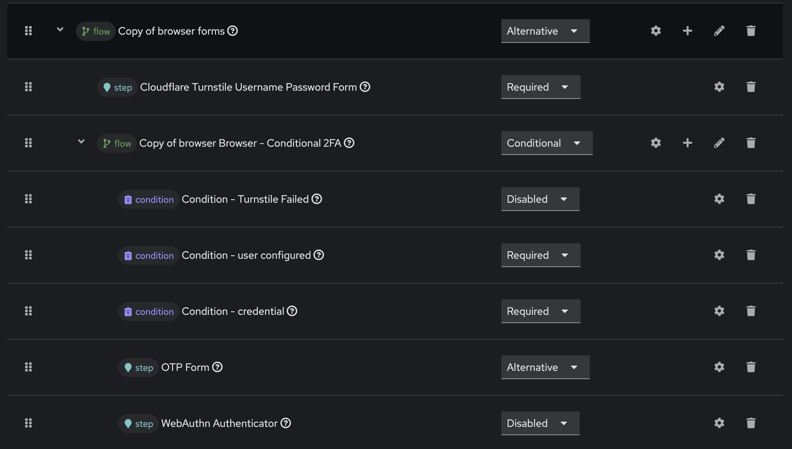

By toggling the `Condition - Turnstile Failed` step between **Required** and **Disabled** you can switch the flow between bot-targeted 2FA and universal 2FA without restructuring the flow.

### Cloudflare Turnstile Validation (registration form action)

**Display name:** `Cloudflare Turnstile validation` (under form actions)

A form action designed specifically for the **Registration** flow. It adds the Turnstile widget to the registration form and validates the challenge when the user submits. The check is automatically skipped if the user is already identified (e.g., in an invite flow).

**When to use:** Add it as a form action inside the built-in Registration flow to prevent bots from bulk-creating accounts through self-registration.

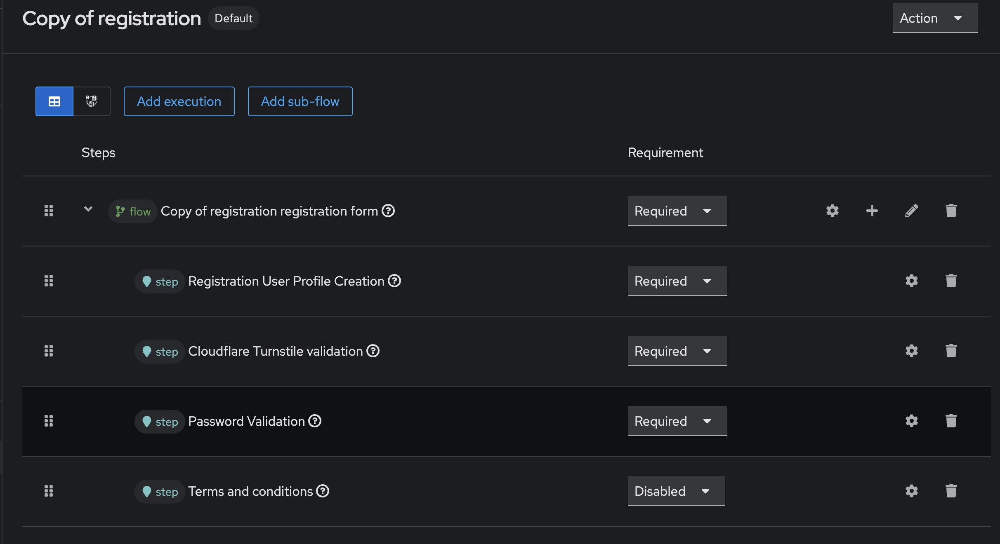

## Installation

1. Build the jar:

```
mvn clean install
```

2. Copy the jar produced in `target/` to your `providers` directory (for Quarkus) or `standalone/deployments` directory (for legacy) and rebuild/restart keycloak.

## Releases

Releases are tagged and published to [Maven Central](https://repo1.maven.org/maven2/io/phasetwo/keycloak/keycloak-magic-link/) after each merge to `main`. Jars can be downloaded from there.

If you are depending on the library in your own Maven-built project, or using a bundling tool in Maven, you can add the dependency like this:

```xml
    <dependency>
      <groupId>io.phasetwo.keycloak</groupId>
      <artifactId>keycloak-magic-link</artifactId>
      <version>VERSION</version>
    </dependency>
```

## Building and testing

Checkout this project and run `mvn clean install`, which will build the source, run all unit/integration tests, and produce a jar in the `target/` directory. The build enforces Google Java formatting standards via [Spotless](https://github.com/diffplug/spotless); run `mvn spotless:apply` to auto-format your code before committing.

### Code formatting

Spotless replaces the previously used Spotify `fmt-maven-plugin`. Use `mvn spotless:check` to verify formatting and `mvn spotless:apply` to fix it.

To enforce formatting automatically before every push, install the provided git pre-push hook:

```
mvn spotless:install-git-pre-push-hook
```

When you push, the hook runs `spotless:check`. If violations are found, it automatically runs `spotless:apply`, aborts the push, and lets you review and commit the formatted files before retrying.

## Implementation Notes

This is a rough outline of the implementation:

- Given an email address
  - see if the email is already associated with a user
    - if yes, use that one
    - if not, create a user (this is configurable)
  - check to see if the redirectUri is valid for the client
    - if yes, continue
    - if not, throw an error
  - create an action token that encodes the user, expiry, clientId and redirectUri
  - action token handler needs to
    - invalidate the action token after single use
    - set the redirectUri
    - make sure to continue the login session after the handler

## Demo

User contributed POC using Jupyter: https://github.com/tstec-polypoly/explore-keycloak

---

All documentation, source code and other files in this repository are Copyright 2024 Phase Two, Inc.
